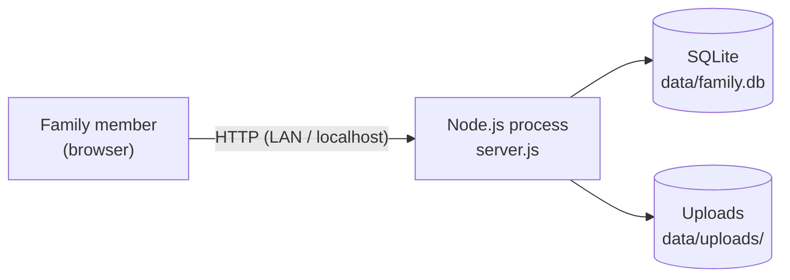
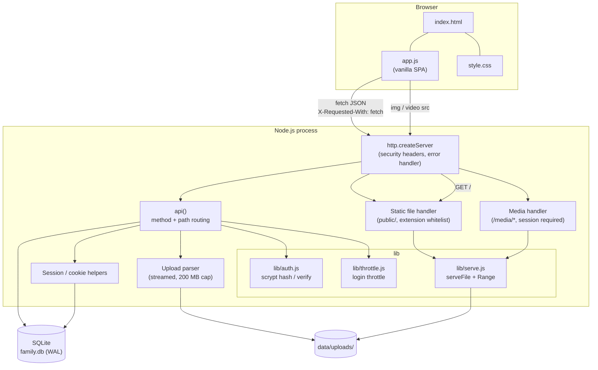
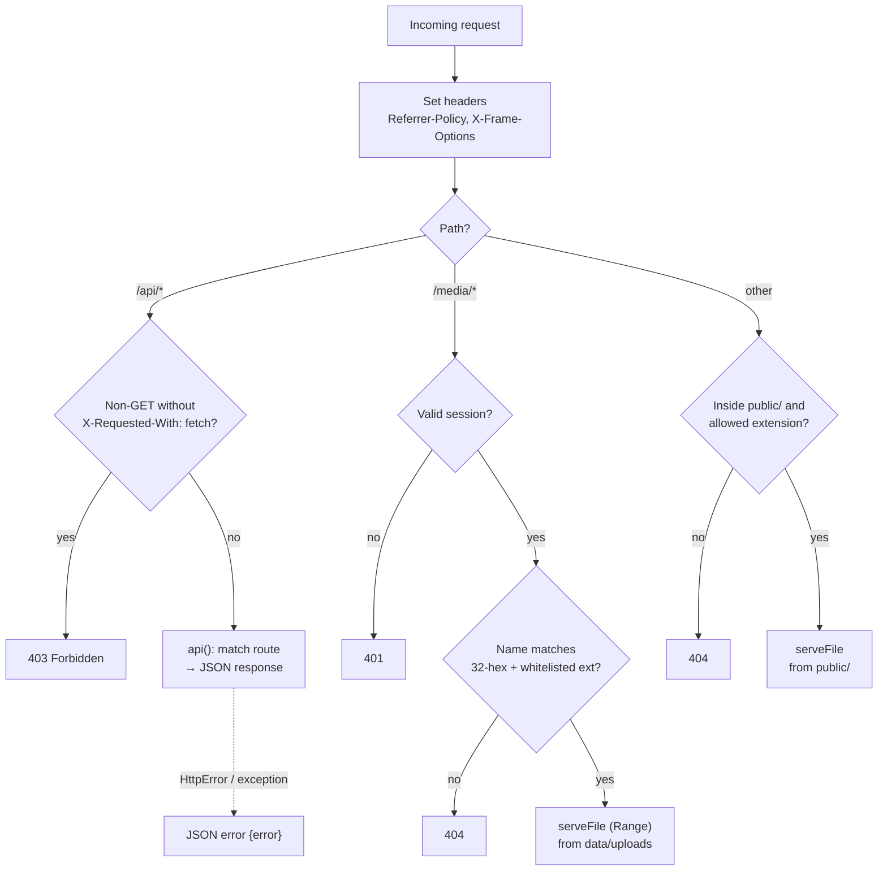
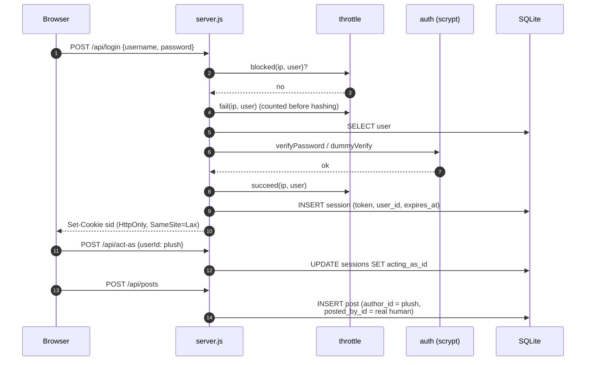
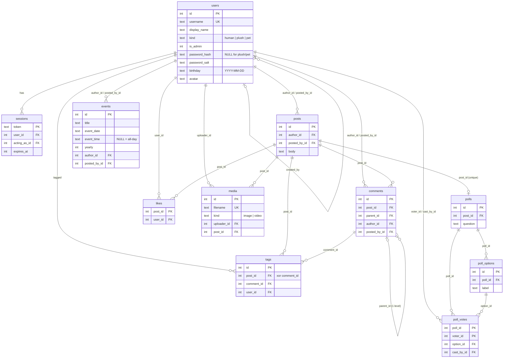
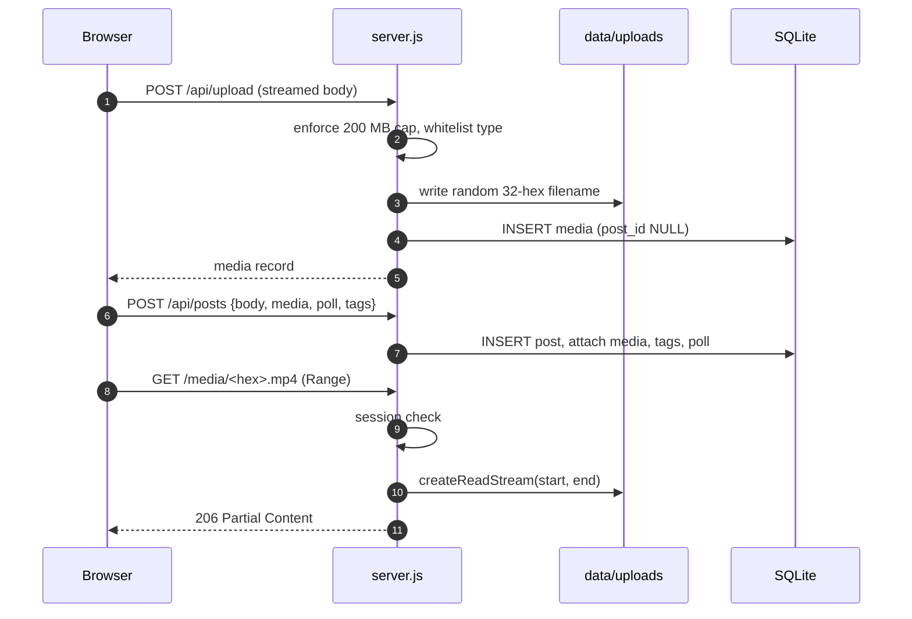
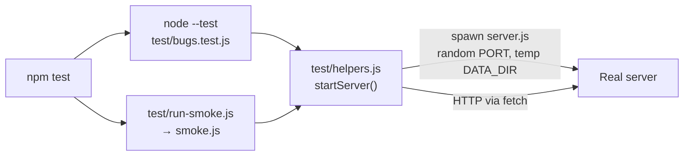

# Family Circle — Architecture

Family Circle is a single-process Node.js app: a plain `http` server, an embedded SQLite database (`node:sqlite`), files on local disk, and a vanilla-JS single-page frontend. There are no third-party dependencies and no build step.

## 1. System context

## 2. Components

## 3. Request routing

## 4. Authentication and "act as"

`author_id` is who the content *appears* from; `posted_by_id` / `cast_by_id` is the real human and is what permission checks (edit, delete) rely on.

## 5. Data model

All foreign keys use `ON DELETE CASCADE` (or `SET NULL` for `users.created_by` and `sessions.acting_as_id`), so removing a member or post cleans up dependent rows. Uploaded files on disk are not part of the schema; they are referenced by `media.filename` and `users.avatar`.

## 6. Media upload and playback

## 7. Test architecture

## Design principles

- **Zero dependencies, zero build:** Node built-ins only; the frontend is served as-is.
- **Private by default:** every API call except login needs a session; media is session-gated. Administrator accounts manage members only and are blocked from feed, post, comment, poll, calendar and act-as routes.
- **Single writer, embedded DB:** SQLite in WAL mode is sufficient for a family-sized workload.
- **Streaming I/O:** uploads and media are streamed with `pipeline()` so large videos don't buffer in memory or leak handles.
